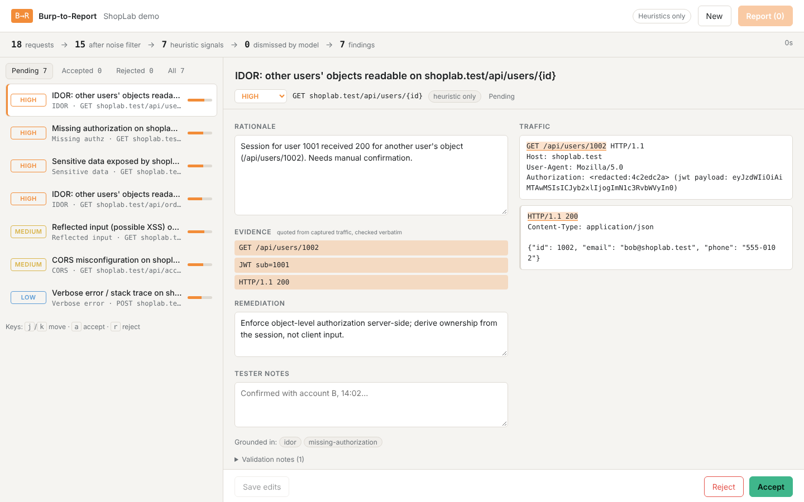

# Burp-to-Report

An AI copilot that turns a Burp Suite traffic export into ranked, evidence-backed vulnerability findings and a submission-ready bug bounty report.

Built for the Meta Global AI Developer Hackathon (Indie track, Theme 1: Build for Your World).



## The problem

One authorized web test produces thousands of requests in Burp's HTTP history. Most of a tester's time goes into scrolling that history looking for broken access control, reflected input and leaked data, then writing a report for each bug. Beginners miss real issues; experienced testers lose hours to repetitive review.

## How it works

```
Burp XML / HAR ──► parse ──► noise filter ──► heuristic detectors ──► Muse Spark review ──► validation ──► human review ──► report
                             (static, dupes,   (high recall,          (per signal, with     (evidence must   (accept /
                              out of scope)     literal evidence)      RAG references)       match traffic)   reject / edit)
```

1. **Parse** Burp Suite XML (base64 or plain) and HAR exports.
2. **Filter noise**: static assets, out-of-scope hosts and exact duplicates are dropped before anything reaches the model.
3. **Heuristic detectors** flag candidates with the literal evidence that triggered them:
   IDOR (JWT `sub` vs object id; one session reading objects with different owners), missing authorization on API routes,
   reflected input, verbose errors and stack traces, sensitive data in responses, and credentialed CORS reflection.
4. **Muse Spark triage**: each signal goes to the model with the relevant traffic and the top reference documents from a local BM25 index. The model decides whether the issue is real, rates severity, and must quote its evidence and cite references.
5. **Validation**: every evidence quote is checked verbatim against the captured traffic, and every citation against the documents actually supplied. Ungrounded claims are dropped, and a finding with no surviving evidence keeps the heuristic evidence at reduced confidence. Each finding records what was dropped and why.
6. **Human in the loop**: the tester accepts, rejects or edits each finding. Nothing is reported automatically.
7. **Report**: accepted findings become Markdown in bug bounty format. Reproduction steps are built from the captured requests rather than generated, so they are always accurate.

### Privacy and safety

- **Credentials are redacted before traffic leaves the machine.** Secret headers (`Authorization`, `Cookie`, `Set-Cookie`, API-key and CSRF headers), secret fields in JSON bodies and query/form parameters (`password`, `token`, `api_key`, …), bare JWTs, AWS keys and private keys become stable placeholders (`<redacted:4c2edc2a>`), so the model can still tell sessions apart. Those values are also masked wherever else they appear, for example a password reflected into a page. JWT payload claims stay visible because IDOR review needs to know whose session it is.
- **Privacy mode** runs a Meta open-weights model locally through any OpenAI-compatible server (Ollama, vLLM, llama.cpp), so client traffic never leaves the tester's machine.
- Projects live in memory only. Nothing is written to disk.
- The tool reads captured traffic. It never sends requests to the target, and the model is instructed not to produce exploit payloads.
- If the model fails, times out or is rate limited, triage falls back to heuristic findings instead of failing.

## Run it

```bash
# backend
cd backend
pip install -r requirements.txt
cp ../.env.example ../.env     # then set META_API_KEY, or leave empty for heuristics only
export $(grep -v '^#' ../.env | xargs)
uvicorn app.main:app --reload --port 8000

# frontend (second terminal)
cd frontend
npm install
npm run dev                    # http://localhost:5173
```

Or as one container: `docker build -t b2r . && docker run -p 127.0.0.1:8000:8000 -e META_API_KEY=... b2r`, then open http://localhost:8000.
The API has no login, so keep it bound to localhost: anyone who can reach the port can upload traffic and read a project if they have its id.

Click **Try the ShopLab demo** to analyze the bundled sample without exporting anything.

### Modes

| Mode | How to enable | Where traffic goes |
|---|---|---|
| Cloud (Muse Spark) | set `META_API_KEY` | Meta Model API, credentials redacted |
| Local (open weights) | `B2R_MODE=local`, `LLM_BASE_URL`, `LLM_MODEL` | stays on your machine |
| Heuristics only | no key, no mode | nowhere; weak signals are filtered by score instead |

## Evaluation

`samples/shoplab.har` is a synthetic export from a fictional practice shop with **7 planted vulnerabilities and 6 decoys** (traffic that looks suspicious but is fine: a user reading their own profile, a public catalogue, encoded output, a harmless echo, wildcard CORS on public data). Regenerate it with `python eval/make_sample.py`.

```bash
python eval/run_eval.py                       # heuristics only
META_API_KEY=... python eval/run_eval.py      # with Muse Spark
```

Heuristics-only result on ShopLab: 7/7 planted issues found, 0 false positives, 18 requests reduced to 15 after noise filtering.

**Caveat:** the detectors and this sample were written together, so this score shows the pipeline works end to end, not how it generalizes.

`samples/juiceshop.har` is two-customer traffic recorded against a local OWASP Juice Shop 20.3 (`python eval/capture_juiceshop.py`), with 7 known challenges as ground truth:

```bash
python eval/run_eval.py --sample samples/juiceshop.har --truth samples/juiceshop_truth.resolved.json
```

Heuristics-only result on Juice Shop: 4/7 found, 0 false positives. Missed: the open `/ftp` directory listing, unauthenticated `/metrics`, and the MD5 password hash inside the login JWT.

## Tests

```bash
cd backend && pytest -q
```

26 tests cover parsing (including malformed uploads), filtering, each detector against planted bugs and decoys, credential redaction in headers, bodies, model prompts and reports, malformed model replies, evidence and citation validation, model suppression of a false positive, fallback when the model returns 503, downgrading of ungrounded model claims, and the full API flow.

## Project layout

```
backend/app/
  parsers.py     Burp XML and HAR parsing
  filters.py     noise filter, path templating
  detectors.py   heuristic detectors (read-only)
  rag.py         BM25 retriever over kb/
  kb/            reference notes: vulnerability classes, severity guide, report writing
  llm.py         OpenAI-compatible client (Meta Model API or local server), retries
  triage.py      redaction, prompting, evidence and citation validation, fallback
  report.py      Markdown report builder
  main.py        FastAPI routes
frontend/src/    React review UI (keyboard triage: j/k, a, r)
eval/            sample generator and scoring script
```

## Use responsibly

Only analyze traffic from systems you are authorized to test, and stay within the program's scope and rules of engagement.
